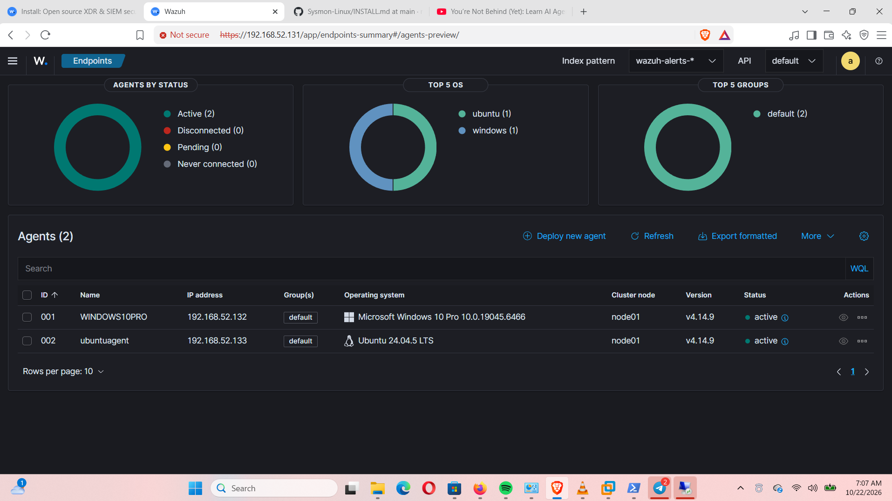
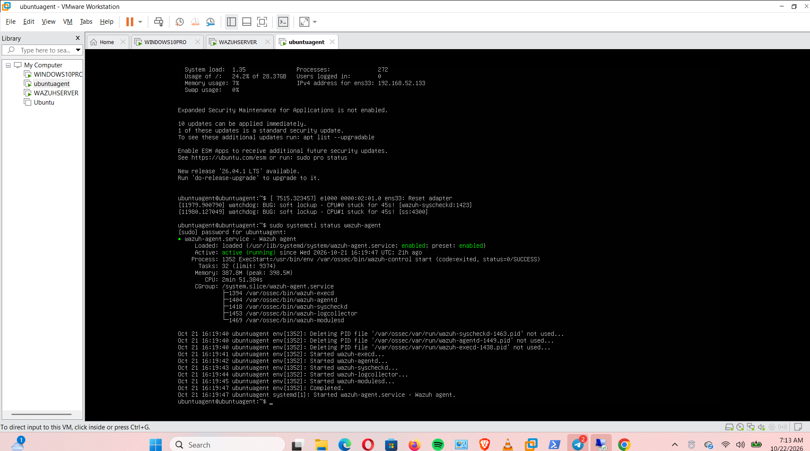

# SOC Home Lab: Wazuh, Windows and Ubuntu

## Why I built this lab

I set up this lab to learn how a SOC analyst gets visibility into activity on computers and uses that information to investigate what is happening. I wanted to understand how the pieces work together, not just install the tools and move on.

The lab runs in VMware Workstation on my Windows host. I have a Ubuntu VM running the Wazuh server, a Windows 10 Pro VM with the Wazuh agent and Sysmon, and a separate Ubuntu VM with the Wazuh agent.

## How the tools work together

### Wazuh

Wazuh is the SIEM I am using for this project. It brings endpoint data into one place so I can check which agents are connected, search collected events, and review alerts. The manager analyses incoming data using its decoders and rules. An alert is something to investigate; it is not proof by itself that an attack happened.

I checked the Wazuh manager service on the Ubuntu server and saw that it was running. In the dashboard, my Windows and Ubuntu agents were also shown as **Active**.

**Evidence — Wazuh manager service**

This terminal screenshot shows the manager service status at the time I checked it.

### Wazuh agents

I installed the Wazuh agent on my Windows endpoint and on a separate Ubuntu endpoint. The agents are the link between those machines and the Wazuh server. What Wazuh can see depends on which log sources and collection settings are configured.

**Evidence — agent status in the dashboard**

Both agents appear as **Active** in this screenshot. That tells me they are connected to the manager; it does not prove that every event source is being collected correctly.

### Sysmon on Windows

Sysmon is a Windows tool that records detailed system activity in the Windows Event Log. It is useful when I need more context about what happened on a machine. Sysmon records events; it does not decide on its own whether an activity is malicious.

Some common Sysmon event types are:

- **Event ID 1 — Process creation:** records a process starting, with details such as the process image and, when configured, the command line.
- **Event ID 3 — Network connection:** records network connections when that event type is enabled in the Sysmon configuration.
- **Event ID 7 — Image loaded:** records a module loaded by a process when enabled.
- **Event IDs 12–14 — Registry activity:** record selected registry key and value changes.

The events available depend on the Sysmon configuration. In my Windows Event Viewer screenshot, the Sysmon Operational log contains recorded events.

**Evidence — Sysmon events on Windows**

This is evidence that Sysmon is recording events locally on the Windows VM.

### How Sysmon data gets to Wazuh

The path I am working to verify is:

1. Sysmon records selected activity in the **Microsoft-Windows-Sysmon/Operational** event channel.
2. The Wazuh agent on Windows is configured to read that channel.
3. The agent sends the collected events to the Wazuh server.
4. Wazuh processes the data so it can be searched and, when a rule matches, may generate an alert.
5. I review the event details and context before deciding whether it needs further investigation.

I have confirmed that Sysmon is recording events locally and that the Windows and Ubuntu agents show as Active in Wazuh. I still need to capture clear dashboard evidence of a specific Sysmon event arriving in Wazuh before I can say that I have verified the full path end to end.

**Evidence — Ubuntu agent service**

This image is included as Ubuntu agent-service evidence. The service status should be read from the terminal output shown in the screenshot; the dashboard's **Active** status alone only confirms the agent connection.

## Lab layout

| Component | What it does in my lab |
|---|---|
| Windows host | Runs the virtual machines |
| VMware Workstation | Provides the virtual lab environment |
| Ubuntu Wazuh server | Receives and analyses endpoint data |
| Windows 10 Pro VM | Windows endpoint running the Wazuh agent and Sysmon |
| Separate Ubuntu VM | Linux endpoint running the Wazuh agent |
| Wazuh dashboard | Lets me check agents, search events and review alerts |
| Windows Event Viewer | Lets me inspect Sysmon events recorded on Windows |

## What I have learned so far

This project has helped me see that installing a SIEM is only the beginning. The event source has to record useful information, the agent has to collect it, and the server has to receive it before I can investigate it in the dashboard. An agent showing as Active is a good first check, but it is not the same as proving that a particular event made it all the way through.

My next steps are to check the Windows agent's Sysmon channel configuration, find a harmless test event, and search for that event in Wazuh. I also want to check whether Wazuh creates an alert for it and understand which rule caused that result.

This is a practice lab, so I am documenting what I have checked and keeping the remaining tests clear rather than marking them as completed before I have evidence.

## Security notes

- I do not include passwords or private keys in this repository.
- I avoid exposing SSH, RDP or the Wazuh dashboard directly to the public internet.
- I check screenshots for sensitive information before publishing them.

## Project notes

- [Project overview](docs/PROJECT-OVERVIEW.md)
- [Deployment notes](docs/DEPLOYMENT.md)
- [Wazuh agent deployment](docs/WAZUH-AGENT-DEPLOYMENT.md)
- [Wazuh installation notes](docs/WAZUH-INSTALLATION.md)
- [Architecture](docs/ARCHITECTURE.md)
- [Components](docs/COMPONENTS.md)
- [Troubleshooting](docs/TROUBLESHOOTING.md)
- [Lessons learned](docs/LESSONS-LEARNED.md)
