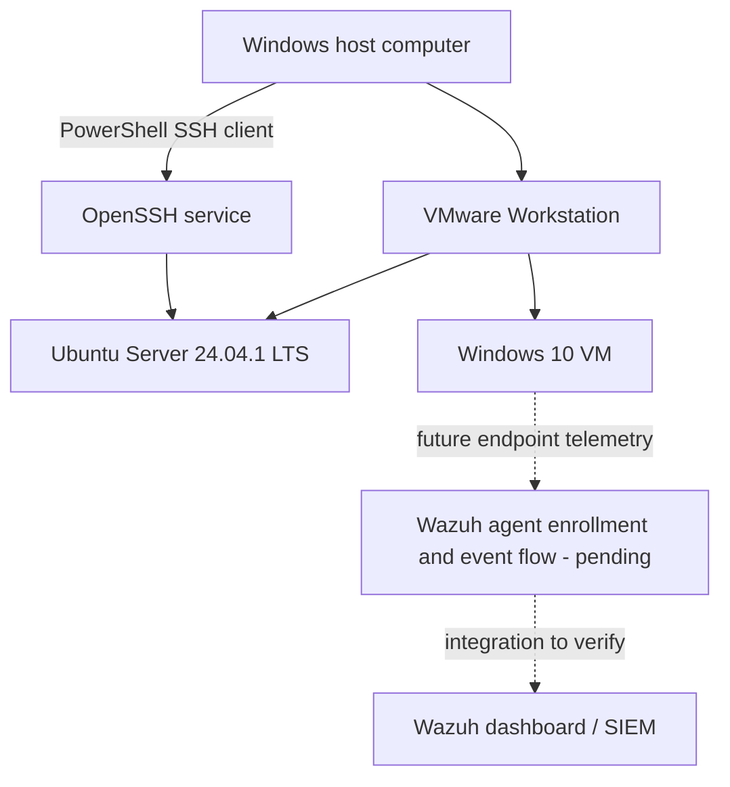

# SOC Home Lab
### Building a Practical Security Operations Centre Lab

---

## Project Overview

This repository documents the staged build of a personal Security Operations Centre (SOC) home lab. The lab uses VMware Workstation on a Windows computer to practise Linux administration, Windows endpoint management, secure remote access, and SIEM-based security monitoring.

The project is documented as a learning environment. Steps are marked as completed only where the available project notes record a successful check. Planned integrations are not presented as operational until they have been tested end to end.

## Objectives

- Build and manage virtual Windows and Linux systems.
- Establish secure administrative access to Ubuntu Server using SSH.
- Learn Windows remote administration with Remote Desktop Protocol (RDP).
- Explore Wazuh as a SIEM/XDR and security-monitoring platform.
- Prepare to collect endpoint telemetry, investigate alerts, and document incident response.
- Record the deployment process, verification steps, known gaps, and lessons learned.

## Environment and Technology Stack

| Layer | Component | Role | Status from current notes |
|---|---|---|---|
| Host / virtualization | Windows computer + VMware Workstation Pro 17 | Runs the virtual lab | In use |
| Linux server | Ubuntu Server 24.04.1 LTS | Linux administration and future monitoring exercises | Installed |
| Remote administration | OpenSSH Server + Windows PowerShell SSH client | Encrypted Ubuntu shell access | Verified |
| Windows endpoint | Windows 10 virtual machine | Endpoint for future monitoring exercises | Desktop startup verified |
| Windows remote access | Remote Desktop Connection (RDP) | Remote Windows administration practice | Connection initiated; session verification pending |
| SIEM | Wazuh dashboard | Central security-monitoring interface | Dashboard accessed; end-to-end ingestion not yet verified |

> **Scope and accuracy:** This is a home lab, not a production SOC. Wazuh agent enrollment, live event ingestion, alert generation, and incident-response testing remain future verification tasks unless documented otherwise.

## Architecture Overview

The diagram separates verified administrative access from the future monitoring path. The exact placement and topology of Wazuh components should be added once the manager, indexer, dashboard, and endpoint agent arrangement is confirmed.

## Current Project Status

| Workstream | Status | Verification / next step |
|---|---|---|
| Ubuntu Server installation | Completed | Installed in VMware Workstation |
| Ubuntu account setup | Completed | Local account configured during installation |
| SSH remote administration | Completed | PowerShell connection and Ubuntu shell prompt confirmed |
| Windows 10 VM | Completed (initial setup) | Desktop startup verified |
| RDP | In progress | Confirm the session opens and the remote desktop can be controlled |
| Wazuh dashboard | Initial access completed | Record component topology and verify services |
| Endpoint onboarding | Pending | Install/register the agent and confirm it is active |
| Log collection and detection | Pending verification | Generate test events, search for them, and validate an alert |

## Documentation

- [Project Overview](docs/PROJECT-OVERVIEW.md) — goals, scope, environment, and current state.
- [Architecture](docs/ARCHITECTURE.md) — components, trust boundaries, and intended event flow.
- [Deployment Journal](docs/DEPLOYMENT.md) — setup steps and verification records.
- [Components and Remote Access](docs/COMPONENTS.md) — Ubuntu, SSH, Windows VM, RDP, and Wazuh roles.
- [Wazuh Agent Deployment](docs/WAZUH-AGENT-DEPLOYMENT.md) — Windows 10 agent installation, service start, connectivity check, and dashboard verification.
- [Security Monitoring Roadmap](docs/SECURITY-MONITORING-ROADMAP.md) — endpoint telemetry and detection validation plan.
- [Troubleshooting](docs/TROUBLESHOOTING.md) — safe checks for common lab issues.
- [Lessons Learned](docs/LESSONS-LEARNED.md) — current takeaways and next improvements.

## Safety and Lab Hygiene

- Use this lab only on systems and networks you own or are authorized to test.
- Keep real passwords, private keys, API tokens, recovery codes, and other secrets out of Git.
- Use placeholders instead of publishing private IP addresses, hostnames, or credentials.
- Keep administrative interfaces on the private lab network; do not expose SSH, RDP, or SIEM ports directly to the public internet.
- Take VM snapshots before major configuration changes and record how to roll back.
- Confirm each integration with evidence before describing it as operational.

## Next Milestones

1. Confirm the RDP session works and document the result.
2. Document the actual Wazuh component deployment and service status.
3. Enroll the Windows 10 endpoint with a Wazuh agent.
4. Verify that the endpoint appears active and that test events reach the dashboard.
5. Run a controlled, harmless detection test and document the alert and investigation steps.
6. Add screenshots only when useful, sanitized, and consistent with the repository's screenshot policy.

---

This documentation describes the lab's recorded state and intended next steps. It does not claim that pending integrations have already been completed.
