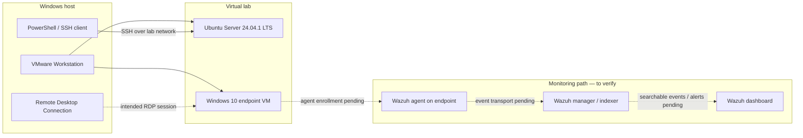

# Architecture
## SOC Home Lab — Components and Data Flow

## 1. Architecture Principles

**Keep the lab isolated.** Use VMware's private or NAT networking for lab traffic unless a specific exercise requires another arrangement. Do not expose management services directly to the public internet.

**Separate administration from monitoring.** SSH and RDP are management paths. Wazuh endpoint telemetry is a monitoring path; successful remote access does not prove that logs are being collected.

**Verify each boundary.** Check VM connectivity first, then service availability, authentication, agent enrollment, and finally event visibility.

**Document the real topology.** The exact Wazuh manager/indexer/dashboard placement and VMware network mode are not fully specified in the current notes and must be confirmed rather than assumed.

## 2. Logical Architecture



Solid arrows show the documented VM and SSH relationship. Dashed arrows indicate an intended path that still needs end-to-end verification.

## 3. Component Responsibilities

| Component | Responsibility | Current evidence |
|---|---|---|
| Windows host | Runs VMware and provides admin tools | In use |
| VMware Workstation Pro 17 | Isolates guest operating systems | Ubuntu and Windows VMs created |
| Ubuntu Server | Linux administration practice and SSH target | Installed; SSH session verified |
| OpenSSH Server | Provides encrypted remote shell access | Enabled and reachable |
| Windows 10 VM | Endpoint for future telemetry collection | Desktop startup verified |
| RDP client/service | Remote Windows desktop administration | Connection initiated; session pending verification |
| Wazuh dashboard | Interface for security monitoring | Accessed; event pipeline not yet verified |

## 4. Administrative Flow: SSH

1. The administrator obtains the Ubuntu guest's current address from the VM console.
2. PowerShell starts an SSH connection to the Ubuntu host.
3. The SSH client checks the server's host key fingerprint when prompted.
4. The user authenticates with the Ubuntu account.
5. SSH encrypts the interactive session after connection setup.
6. The remote shell allows authorized commands to be executed on Ubuntu.

The host fingerprint verifies the identity of the SSH server; it is not the user's password and does not authenticate the user by itself.

Example command (replace placeholders with the current lab values):

```powershell
ssh <ubuntu-username>@<ubuntu-lab-ip>
```

## 5. Intended Monitoring Flow

1. Windows generates security and system events.
2. A Wazuh agent on the Windows endpoint collects configured telemetry.
3. The agent sends events to the Wazuh manager.
4. Wazuh decodes and evaluates the events using configured rules.
5. Events and alerts become available through the indexer/dashboard components.

Steps 2–5 must be validated in this lab. Merely opening the dashboard does not demonstrate that an endpoint is connected or producing searchable events.

## 6. Trust Boundaries

- **Host-to-guest boundary:** VMware virtual networking separates guest workloads from the host, but it is not a substitute for host security.
- **SSH boundary:** Protect credentials and verify the server fingerprint before trusting a new host.
- **RDP boundary:** Permit access only from intended lab systems and use a dedicated account with appropriate permissions.
- **SIEM boundary:** Use protected enrollment credentials and restrict manager communication to the lab network.
- **Repository boundary:** Public documentation should not contain passwords, private keys, enrollment secrets, or unnecessary network details.

## 7. Architecture Details to Record Next

- VMware network mode (NAT, host-only, or bridged) and why it was chosen.
- Current IP assignment method for each VM, with public-facing documentation using placeholders.
- Where Wazuh manager, indexer, and dashboard are installed.
- Which ports are required between the endpoint and Wazuh manager in this specific deployment.
- Which Windows event channels are collected and how a test event is verified.
